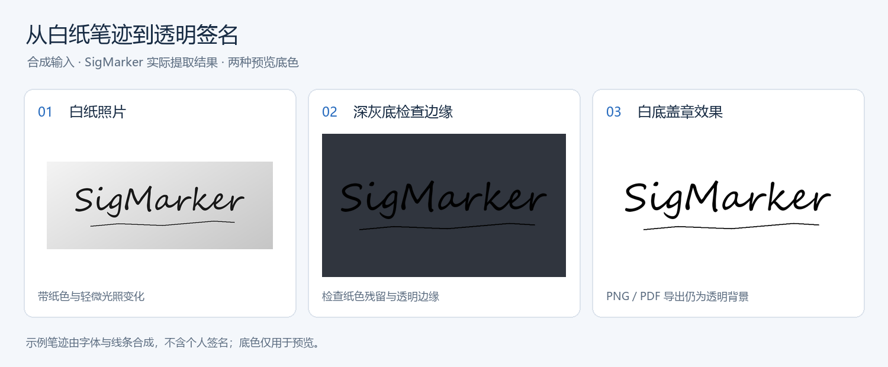

# SigMarker

**把白纸上的手写笔迹，变成透明签名。**

Windows 桌面工具 · 手机扫码传图 · 透明 PNG / PDF · PDF-XChange 图章

[快速开始](#快速开始) · [手机扫码](#手机扫码) · [使用指南](docs/usage.md) · [开发与打包](docs/development.md) · [GitHub](https://github.com/winloud/sigmarker)

合成笔迹示例，不含真实签名。预览使用实际提取结果；深灰与白色底板不会写入导出文件。

## 为什么用 SigMarker

扫描件里签名带着纸色，手机照片又常有阴影。SigMarker 将笔迹与纸张背景分离，保留透明边缘，方便复制到文档或制作水印图章。

| 能力 | 你可以做什么 |
| --- | --- |
| 多种导入方式 | 打开、拖入或从剪贴板粘贴图片和本地文件，也可用手机扫码拍照上传；支持 HEIC/HEIF。 |
| 自动去纸色 | 自动校正背景亮度和光照，检测笔迹范围，再按需要调整裁剪框。 |
| 可控的笔迹效果 | 调整淡墨保留、墨迹浓度、不透明度和墨色，清除孤立噪点。 |
| 双底色预览 | 同时检查深灰底的透明边缘，以及签名盖在白纸上的效果。 |
| 复制与导出 | 复制透明签名，导出透明 PNG 或带透明蒙版的 PDF。 |
| 图章与尺寸 | 追加到 PDF-XChange 图章集合；统一 DPI，按毫米检查物理尺寸。 |

桌面提取在本机完成。手机导入通过临时局域网服务传图，不需要手机 App 或云服务器。

## 快速开始

### 使用 Windows 便携包

1. 保留整个 `SigMarker/` 文件夹，双击其中的 `SigMarker.exe`。便携包无需安装 Python，`_internal/` 必须与 EXE 放在一起。
2. 拖入扫描件或图片，或点击 **手机扫码导入…**。支持 PNG、JPEG、BMP、TIFF、HEIC/HEIF 和 PDF。
3. 检查自动裁剪范围，拖动框体或手柄微调；必要时旋转图片、调整笔迹参数。
4. 点击 **复制透明签名**，或导出 PNG / PDF。

> 当前仓库尚未发布 GitHub Release 下载。已有便携包可直接使用；从源码获取项目时，请按 [开发与打包](docs/development.md) 生成便携包。默认构建入口为 `dist/SigMarker/SigMarker.exe`。

### 常用操作

| 操作 | 入口 |
| --- | --- |
| 打开本地文件 | 画布中央 **打开 PDF / 图片…**、拖入文件，或 `Ctrl+O` |
| 粘贴导入 | `Ctrl+V` 粘贴剪贴板图片或复制的本地文件 |
| 手机传图 | 画布中央 **手机扫码导入…**，或文件菜单 |
| 调整范围 | 拖动裁剪框及其手柄；画布右上角可旋转、重新自动框选 |
| 关闭当前文件 | 画布右上角 **关闭文件**，或 `Ctrl+W` |
| 查看项目信息 | **关于 → 关于 SigMarker… / GitHub 仓库** |
| 退出 | `Ctrl+Q` |

## 手机扫码

**电脑开启 → 手机扫码 → 拍照 / 选择图片 → 电脑接收。**

1. 手机与电脑连接可互访的局域网。在电脑点击 **手机扫码导入…**，选择合适的 WLAN 或以太网地址。
2. 手机扫码，在浏览器中拍照或选择相册图片。支持 JPEG、PNG、HEIC/HEIF。
3. 电脑没有打开文件时自动载入；已有文件时先显示接收预览，点击 **使用此照片** 才替换。

每个二维码有效 **10 分钟**，只接收 **1 张**有效照片；单张限制 **30 MiB / 6000 万像素**。收到照片、过期或关闭窗口后停止服务。重新拍摄或继续导入时，需在电脑重新开启并扫码。

> 手机照片仅临时保存，放弃、关闭对应文件、成功替换或退出时清理。局域网 HTTP 传输未加密，请在可信网络使用。详见 [手机导入与网络排查](docs/usage.md#手机导入与网络排查)。

实机验证：三星 S20U（安卓）已确认微信或相机软件扫码、拍照上传及 HEIC 上传正常；其他机型与浏览器仍需分别验收。

## 常见问题

**笔画缺失或太浅？** 先增大“淡墨保留”找回细笔画；已保留的笔画偏浅时，再提高“墨迹浓度”。后者只加深保留下来的墨迹，不能找回已被清除的笔画。

**为什么导出的 PNG 看起来仍是白底？** 图片查看器可能用白色显示透明区。使用软件的深灰预览检查透明边缘，或放到有颜色的文档背景上查看。

**粘贴或盖章时大小不合适？** 调整右侧“导出 DPI”，并检查预览下方的毫米尺寸。DPI 越大，物理尺寸越小，像素数不变；接收软件仍可能自行缩放。

**自动选框包含了日期或正文？** 自动检测寻找的是笔迹范围，不识别姓名、日期或印刷文字的含义。拖动裁剪框，留下需要的部分即可。

**手机连不上电脑？** 检查二维码中的网络地址、Windows 防火墙、Wi-Fi 客户端隔离和 VPN/代理路由。两台设备必须能够互相访问，仅 Wi-Fi 名称相同并不足够。[查看排查步骤](docs/usage.md#手机导入与网络排查)

## 使用边界

- 面向白纸扫描件和白纸签名照片。复杂正文、桌面背景或纸边可能需要手动调整裁剪范围。
- PDF 当前仅读取第 1 页；HEIC 使用主图和容器方向，其余图片按 EXIF 修正方向。
- 保留原始像素，不通过放大制造细节；预览底色不会写入导出文件。
- 图章写入成功只表示集合文件已保存，不代表 PDF-XChange 图章面板已刷新。[图章导入说明](docs/usage.md#添加到-pdf-xchange-图章)

## 更多文档与反馈

- [使用指南](docs/usage.md)：笔迹参数、DPI、图章导入、手机网络与临时文件。
- [开发与打包](docs/development.md)：源码运行、回归验证、便携包构建与项目结构。
- [问题反馈](https://github.com/winloud/sigmarker/issues)：请提供复现步骤、文件格式、图像尺寸和运行环境；示例图片请先脱敏，优先使用合成笔迹。
